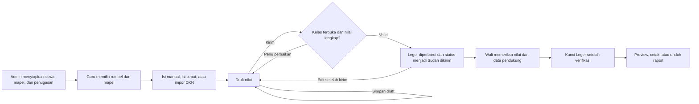

# Workflow RADISTES

Dokumen ini merekam alur yang terlihat pada frontend RADISTES, termasuk edit dan impor biodata siswa oleh Admin. Gunakan [Dokumentasi Perilaku Frontend](perilaku-frontend-radistes.md) untuk detail aturan dan contoh uji. Gunakan [Master Plan RADISTES](../master%20plan.md) untuk urutan pembangunan Go dan rencana integrasi dengan SI-MATSAMA.

## Portal dan cakupan kerja

| Menu | Admin | Wali Kelas | Guru Mapel |
| --- | --- | --- | --- |
| Dashboard | Ringkasan siswa, rombel, guru yang sudah menyelesaikan semua penugasan aktif, dan tahun aktif. | Ringkasan kelas asuh dan tiga peringkat kelas. Jika memiliki penugasan mengajar, panel kelas yang diampu ikut tampil. | Tenggat, ringkasan tiap penugasan, dan tiga nilai terbaik per mapel dan rombel. |
| Data Siswa | Melihat lintas rombel. Dapat mengedit identitas dan biodata, serta mengimpor biodata Excel untuk siswa terdaftar. | Melihat rombel sendiri dan mengisi tempat lahir, tanggal lahir, serta nama orang tua. | — |
| Data Master | Wali Kelas, Guru Mapel, dan Mata Pelajaran. | — | — |
| Setor Nilai | Memantau setoran per guru, rombel, dan mapel serta mengekspor daftar status. | Mengisi dan mengirim nilai untuk penugasan mengajarnya. | Mengisi dan mengirim nilai untuk penugasan mengajarnya. |
| Leger | Memilih rombel, memeriksa dan mengoreksi nilai, mengimpor DKN langsung, serta mengunci atau membuka Leger. | Memeriksa, mengoreksi, dan mengunci atau membuka Leger rombel asuh. | — |
| Raport | Memfilter lintas rombel, membuka preview, mengunduh PDF langsung, dan mengekspor Leger. | Mengakses raport rombel asuh, membuka preview, mencetak atau menyimpan PDF lewat dialog cetak, dan mengekspor Leger. | — |
| Nilai Terbaik | — | Tiga nilai mapel terbaik per penugasan mengajar. | Tiga nilai mapel terbaik per penugasan mengajar. |
| Pengaturan | Identitas madrasah, periode, tenggat, tanggal raport, kop, dan tanda tangan kepala madrasah. | NIPY dan tanda tangan wali kelas untuk rombel asuh. | — |

Sumber cakupan portal tersedia di [Sidebar](../frontend/src/components/layout/Sidebar.jsx), [Dashboard](../frontend/src/app/page.jsx), dan [AppContext](../frontend/src/context/AppContext.jsx).

## A. Siapkan periode dan data induk

1. Admin mengisi tahun pelajaran, semester, tenggat, tanggal pembagian raport, kop, serta tanda tangan dan NIPY kepala madrasah di **Pengaturan**.
2. Admin memeriksa siswa dan rombel di **Data Siswa**. Untuk memperbarui biodata sekaligus, buka **Impor Biodata Excel**, unduh template hasil filter, isi tempat lahir, tanggal lahir, atau nama orang tua yang perlu diperbarui, lalu unggah dan konfirmasi impor. RADISTES mencocokkan NIS dan rombel dengan siswa terdaftar. Sel biodata kosong mempertahankan isi sebelumnya. Pada frontend saat ini, tombol **Tambah Siswa** masih berupa placeholder.
3. Admin memilih mapel aktif dan mengatur urutannya di **Mata Pelajaran**. Kolom Leger mengikuti urutan tersebut. PAI dan MULOK masing-masing mempunyai aturan pilihan antara induk atau submapel.
4. Admin menentukan wali setiap rombel melalui **Wali Kelas**. Saat wali dipindah ke rombel yang sudah memiliki wali, UI menampilkan pertukaran penugasan. Template dan impor Excel tersedia.
5. Admin membuat penugasan **Guru Mapel**. Satu guru dapat mengampu satu mapel di beberapa rombel atau memiliki beberapa penugasan mapel. Untuk impor, satu baris Excel mewakili satu kombinasi guru, rombel, dan mapel.

Wali kelas dapat mulai melengkapi biodata dan tanda tangan segera setelah penugasan tersedia. Penugasan wali untuk mengurus kelas dan penugasan mengajar mapel digunakan untuk dua cakupan akses yang berbeda.

## B. Isi draft dan kirim nilai

1. Guru membuka **Setor Nilai** dan memilih **Kelas → Bagian → Mata Pelajaran** dari penugasannya. Wali kelas yang mengajar masuk melalui menu yang sama.
2. Guru mengisi **UH 1–5** dan **STS** secara manual, memakai **Isi Nilai Cepat**, atau mengimpor DKN untuk pilihan saat ini. Impor di halaman ini mengisi draft.
3. **Simpan Draft Nilai** menyimpan perubahan ke browser. Nilai Leger dan status **Sudah dikirim** berubah melalui aksi **Kirim Nilai ke Wali Kelas**.
4. Saat kirim, aplikasi memeriksa kelas belum terkunci dan semua siswa mempunyai STS serta rata-rata yang valid. Nilai akhir yang masuk Leger adalah rata-rata STS dan UH yang terisi, dibulatkan ke bilangan bulat.
5. Wali memeriksa hasilnya di Leger rombel asuh. Admin melihat perubahan status melalui menu **Setor Nilai**. Jika guru mengubah draft setelah pengiriman, status guru menjadi **Perubahan belum dikirim** sampai dikirim ulang.

Leger dan Setor Nilai berbagi state frontend dalam aplikasi yang sama. Untuk alur lintas akun dan perangkat, Go harus menyimpan setoran dan Leger di server.

## C. Verifikasi Leger dan lengkapi raport

1. Wali kelas membuka **Leger** untuk rombelnya. Admin memilih rombel dari filter. Gunakan tab nilai untuk memeriksa mapel aktif, jumlah, rata-rata, dan peringkat.
2. Koreksi nilai jika perlu. Nilai yang diketik di Leger dibulatkan setelah Enter atau pindah fokus. Lengkapi **Ekskul, Akhlak & Absensi**, termasuk catatan untuk orang tua.
3. Wali kelas membuka **Data Siswa** untuk memastikan nama orang tua terisi. Nama tersebut dipakai di bagian tanda tangan **Orang Tua / Wali**.
4. Wali kelas menyimpan NIPY serta gambar tanda tangan di **Pengaturan**. Admin mengisi bagian kepala madrasah dan kop melalui Pengaturan Admin.
5. Setelah pemeriksaan, wali kelas atau admin dapat **Kunci Leger**. Kunci membuat input nilai dan data pendukung menjadi nonaktif di UI dan mencegah pengiriman nilai ke kelas tersebut. Kebijakan wajib lengkap sebelum kunci dan wajib terkunci sebelum terbit masih perlu diputuskan untuk Go. Frontend saat ini menampilkan petunjuk verifikasi, sementara aksi kunci dan akses cetak mempunyai perilaku tersendiri.

## D. Preview, cetak, dan unduh

1. Buka **Raport**. Admin menyaring rombel atau siswa. Wali kelas masuk langsung ke rombel asuh. Tombol mata membuka preview per siswa dengan navigasi siswa sebelumnya dan berikutnya.
2. Periksa kop, tanggal, nilai, data pendukung, dan nama orang tua. Bagian tanda tangan berurutan **Kepala Madrasah → Wali Kelas → Orang Tua / Wali**. Raport memakai format A4.
3. Admin dapat mengunduh PDF langsung. Wali kelas dapat mencetak atau menyimpan ke PDF melalui dialog cetak. Aksi massal mengikuti seluruh hasil filter, termasuk baris di halaman lain.
4. Gunakan **Unduh Leger Excel** untuk rekap model RDM. Halaman Raport juga memiliki aksi cetak Leger. Untuk penerbitan resmi dan arsip versi raport, ikuti rancangan di Master Plan.

Sumber langkah operasional tersedia di [Setor Nilai](../frontend/src/app/setor-nilai/page.jsx), [Leger](../frontend/src/app/leger/page.jsx), [Raport](../frontend/src/app/cetak-raport/page.jsx), dan [Pengaturan](../frontend/src/app/pengaturan/page.jsx).
